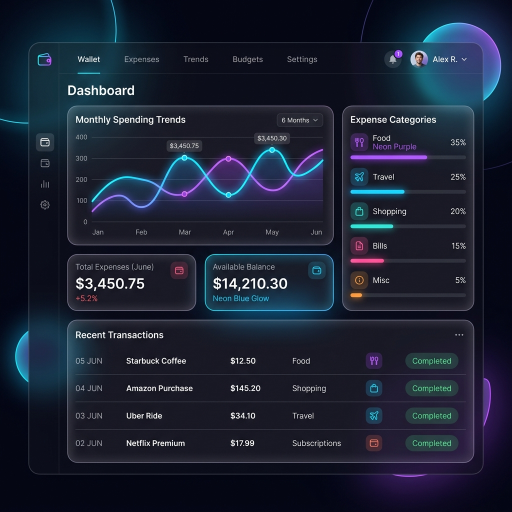
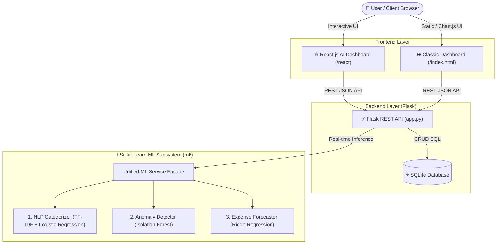

# 💰 PyFin - AI-Powered Personal Expense Tracker

A full-stack, AI/ML-driven personal finance and expense management platform built with **Python (Flask)**, **Scikit-Learn Machine Learning**, and **React.js**. Features an intelligent glassmorphism UI, real-time Natural Language Processing (NLP) for auto-categorization, unsupervised anomaly detection for overspending, and time-series spending forecasting.


---

## 📸 Visual Showcase

<div align="center">
  
  <p><em>Modern Glassmorphism UI with Real-time Financial Analytics and ML-Powered Insights</em></p>
</div>

---

## 🏛️ System Architecture



---

## 🧠 Machine Learning Capabilities

### 1. 📝 NLP Expense Categorizer (Supervised Learning)
* **Algorithm**: `TfidfVectorizer` (sublinear TF scaling, unigrams + bigrams) + Balanced `LogisticRegression`.
* **Inference**: As the user types in the description field (*e.g., "Swiggy dinner biryani"*, *"Uber ride to airport"*), a debounced request hits `/api/ml/predict-category`.
* **Output**: Returns the predicted category (*Food, Travel, Bills, Shopping, etc.*) along with calibrated confidence scores, auto-filling the category selection.

### 2. 🚨 Outlier & Anomaly Detection (Unsupervised Learning)
* **Algorithm**: `IsolationForest` (100 ensemble trees, 5% contamination factor) with per-category Z-Score statistical thresholds.
* **Inference**: Evaluates transaction amounts in real-time.
* **Output**: Warns user if an amount is abnormal for its category (*e.g., entering ₹15,000 for a lunch entry*), guarding against input typos and impulsive spending.

### 3. 📈 Time-Series Monthly Expense Forecaster (Regression)
* **Algorithm**: `Ridge Regression` with calendar & lag features (*Day of Month, Day of Week, Weekend indicator, 7-day rolling average*).
* **Output**: Replaces naive arithmetic with a regression model that projects end-of-month financial expenditure and daily burn rate based on actual spending velocity.

### 4. 🔄 Dynamic Model Re-training Pipeline
* Accessible via `POST /api/ml/retrain` to continuously adapt model weights as user transaction history expands.

---

## ⚛️ Dual Frontend Architecture

1. **React.js Dashboard (`/react` & `client/`)**:
   * Built with **React 18** functional components and modern hooks (`useState`, `useEffect`, `useCallback`, `useMemo`).
   * Real-time reactive AI suggestions and anomaly alerts.
   * Dynamic transaction deletion, filtering, and live state updates.
2. **Classic Web Dashboard (`/` & `index.html`)**:
   * Lightweight Vanilla JavaScript + HTML5/CSS3 + Chart.js interactive charts.

---

## 🛠️ Tech Stack

* **Machine Learning**: `scikit-learn`, `pandas`, `numpy`, `joblib`
* **Backend**: `Python 3`, `Flask`, `SQLite3`
* **Frontend**: `React 18`, `Chart.js`, `Vanilla JavaScript (ES6+)`, `HTML5`, `CSS3` (Custom Glassmorphism)

---

## 📂 Project Structure

```plaintext
Personal-Expensive-Tracker/
│
├── ml/                                # Machine Learning Subsystem
│   ├── dataset.py                     # Synthetic financial transaction data generator
│   ├── nlp_classifier.py              # TF-IDF + Logistic Regression categorizer
│   ├── anomaly_detector.py            # Isolation Forest outlier detection
│   ├── forecaster.py                  # Ridge Regression time-series forecaster
│   ├── service.py                     # Unified ML Service facade
│   └── models/                        # Serialized .joblib trained model artifacts
│
├── client/                            # React.js Vite Project
│   ├── src/
│   │   ├── App.jsx                    # Main React application component
│   │   ├── main.jsx                   # React DOM root
│   │   └── index.css                  # Modern styling
│   ├── package.json
│   └── vite.config.js
│
├── assets/
│   └── images/                        # UI Mockups & graphics
├── app.py                             # Flask API & static file server
├── react-app.html                     # Standalone React 18 SPA served via Flask
├── index.html                         # Classic dashboard
├── home.html                          # Landing page
├── login.html                         # Authentication UI
├── script.js                          # Client-side logic & ML API hooks
├── style.css                          # Glassmorphism styling system
├── requirements.txt                   # Python dependencies
└── README.md                          # Project documentation
```

---

## 🚀 Getting Started

### 1. Prerequisites
* Python 3.8+ installed
* Node.js (v18+) *(optional, for standalone Vite development)*

### 2. Clone the Repository
```bash
git clone https://github.com/pardhavisaimalisetti-pyd/Personal-Expensive-Tracker.git
cd Personal-Expensive-Tracker
```

### 3. Install Python Dependencies
```bash
pip install -r requirements.txt
```

### 4. Run the Application
```bash
python app.py
```

### 5. Access the Dashboards in Your Browser
* ⚛️ **React.js AI Dashboard**: **[http://127.0.0.1:5000/react](http://127.0.0.1:5000/react)**
* 📊 **Classic Dashboard**: **[http://127.0.0.1:5000/index.html](http://127.0.0.1:5000/index.html)**
* 🌐 **Landing Page**: **[http://127.0.0.1:5000/](http://127.0.0.1:5000/)**

*(Optional)* Run the React Vite Dev Server:
```bash
cd client
npm install
npm run dev
```

---

## 🔌 REST & ML API Endpoints

| Method | Endpoint | Description |
| :--- | :--- | :--- |
| `GET` | `/` | Serves Landing Page |
| `GET` | `/react` | Serves React.js AI Dashboard |
| `GET` | `/api/transactions` | Retrieve all transactions |
| `POST` | `/api/transactions` | Add a new transaction |
| `DELETE` | `/api/transactions/<id>` | Delete transaction by ID |
| `POST` | `/api/ml/predict-category` | **NLP**: Predicts category & confidence score from text |
| `POST` | `/api/ml/detect-anomaly` | **ML**: Detects abnormal spending using Isolation Forest |
| `GET` | `/api/ml/forecast` | **ML**: Time-series monthly spending projection |
| `GET` | `/api/ml/metrics` | Returns model evaluation metrics (Accuracy, F1, MAE) |
| `POST` | `/api/ml/retrain` | Triggers model re-training pipeline |

---

## 💡 Troubleshooting: "Can't reach this page"

If your browser displays *"Can't reach this page"* or *ERR_CONNECTION_REFUSED*:
1. Make sure the Flask server is running in your terminal:
   ```bash
   python app.py
   ```
2. Verify that the output shows:
   ```
   * Running on http://127.0.0.1:5000
   ```
3. Open **[http://127.0.0.1:5000/react](http://127.0.0.1:5000/react)** in your browser.

---

## 👤 Author

* **GitHub**: [@pardhavisaimalisetti-pyd](https://github.com/pardhavisaimalisetti-pyd)

---

## 📄 License

This project is licensed under the MIT License.
